# Essay Master 현재 작업 마인드맵

생성일: 2026-08-23  
분석 기준: `todo.md`, `client/src/App.tsx`, `server/routers.ts`, `drizzle/schema.ts`, 최근 Git 커밋, 주요 `client/src`, `server`, `docs`, `scripts` 파일

```mermaid
mindmap
  root((Essay Master))
    제품 목적
      논술·글쓰기 학습 플랫폼
      AI 첨삭과 교사 첨삭 결합
      과정별 학습·문제은행·수료 관리
      학생·교사·관리자·학부모 역할 기반 운영
    사용자 역할
      학생
        커리큘럼 학습
        워크북 풀이
        AI 자동 첨삭
        오답 노트
        수료증 발급
        과제 제출
      교사
        교사회원 가입
        승인 대기·승인 완료 상태
        지도 학생 관리
        첨삭 피드백 작성
        교사 AI 초안 생성·수정·승인
        수료 승인 요청 처리
      관리자
        대시보드·분석 지표
        커리큘럼 운영
        문제은행 운영
        수료증 관리
        교사 권한 승인
        AI 평가 모델 관리
        약관·개인정보 문서 관리
      총괄관리자
        전체 계정 상태 관리
        학생·교사·관리자 통합 콘솔
      학부모
        학생 계정 연동
        학습 상황 확인
        학부모 코멘트 관리
    프론트엔드 라우트
      홈
        Home.tsx
        역할별 CTA
        허위 통계 제거
        접근성·포커스 테스트
      인증
        Login.tsx
        Signup.tsx
        TeacherSignup.tsx
        VerifyEmail.tsx
        ForgotPassword.tsx
        ResetPassword.tsx
        SocialProviderSettings.tsx
      학습
        Curriculum.tsx
        CurriculumDetail.tsx
        Workbook.tsx
        QuizPage.tsx
        ParagraphReordering.tsx
        SummaryPractice.tsx
        TopicWizard.tsx
        ThesisChecklist.tsx
      첨삭
        EssaySubmission.tsx
        EssayArchive.tsx
        AIAutoFeedback.tsx
        AIFeedbackCompare.tsx
        TeacherFeedback.tsx
        OfflineEssays.tsx
      개인화
        MyPageHub.tsx
        Dashboard.tsx
        MistakeNotebook.tsx
        Certificate.tsx
        Notifications.tsx
        AiGuideHistory.tsx
        WritingExampleLibrary.tsx
      교사
        TeacherMyPage.tsx
        TeacherWritingExamples.tsx
        StudentAssignments.tsx
      관리자
        AdminDashboard.tsx
        AdminCurriculumManager.tsx
        AdminQuestionBank.tsx
        AdminTheoryContent.tsx
        AdminLessonConnections.tsx
        AdminCertificates.tsx
        AdminAcademicPermissions.tsx
        AdminEvaluationModels.tsx
        AdminAIGovernance.tsx
        AdminTermsManager.tsx
        MasterAdminConsole.tsx
        ParentPortal.tsx
    백엔드 API
      tRPC Router
        auth
          이메일 회원가입·로그인
          교사회원 가입
          이메일 인증
          비밀번호 재설정
          프로필·아바타
        curriculum
          과정 조회
          동적 커리큘럼
          이론 콘텐츠
          워크북 문제·답안
          오답·알림·배지
        theoryContent
          이론 콘텐츠 CRUD
          AI 초안 생성
          레슨 연결
          학습 체크 완료
        progress
          진도 저장·조회
        quiz
          문장 교정 제출
          상세 문장 피드백
        certificate
          수료 자격
          발급
          공유 토큰 조회
        essaySubmission
          논술 제출·수정·조회
        teacherFeedback
          교사 피드백
          문장별 코멘트
        aiAutoFeedback
          AI 첨삭 생성
          일일·주간 사용량
          provider 오류 메시지 보존
        teacherAi
          교사 AI 프로필
          스타일 예시
          첨삭 초안
          수정 이력
          최종 승인
        questionBank
          문항 CRUD
          랜덤 출제
          오답 기록
          난이도 분석
          AI 문항 생성
          통계·추이·인사이트
          북마크·피드백
        admin
          교사 권한
          수료 승인 정책
          분석 지표
          학생 상세
          커리큘럼 관리
        aiGovernance
          교사 AI 정책
          동의·감사
          데이터 처리 요청
        social
          OAuth 제공자 설정
        push
          웹 푸시 설정
        notifications
          구독·해제·테스트 알림
    데이터 모델
      계정·권한
        users
        social_provider_config
        app_secret_config
        teacher_permission_grants
        admin_audit_logs
      학부모·교실
        parent_student_links
        learning_groups
        learning_group_members
        class_attendance
        class_announcements
        class_assignments
        class_assignment_submissions
        class_assignment_ai_feedbacks
      커리큘럼·진도
        curriculum
        dynamic_curriculum
        progress
        lesson_theory_content
        lesson_theory_drafts
        lesson_theory_progress
        workbook_lesson_connections
      워크북·문제은행
        question_bank
        question_bank_trash
        question_bank_maintenance_settings
        question_bank_operation_logs
        question_feedbacks
        question_bookmarks
        curriculum_workbook_questions
        curriculum_workbook_answers
        workbook_mistakes
        learning_tool_mistakes
      첨삭·평가
        essay_submission
        teacher_feedback
        feedback_comment
        ai_auto_feedback
        evaluation_model_configs
        writing_evaluation_records
        evaluation_model_operations
        evaluation_review_queue
        evaluation_appeals
        ai_usage_logs
      교사 AI
        teacher_ai_profiles
        teacher_ai_style_examples
        teacher_ai_drafts
        teacher_ai_draft_revisions
        teacher_feedback_templates
        approved_writing_examples
        workbook_teacher_feedback
      수료·인증
        certificate
        certificate_approval_policies
        certificate_approval_requests
      정책·알림
        policy_documents
        user_policy_consents
        data_processing_requests
        push_subscription
        app_notifications
        site_settings
      성취
        user_badges
        learning_tool_attempts
        sentence_feedback_cache
        quiz_answer
        ai_lesson_guide_histories
    AI 기능
      자동 첨삭
        writingCorrectionEngine.ts
        aiFeedback.ts
        configuredWritingEvaluation.ts
        AIAutoFeedback.tsx
        AIFeedbackCompare.tsx
      평가 모델 운영
        evaluationModelRegistry.ts
        evaluationMetrics.ts
        AdminEvaluationModels.tsx
        AdminAIGovernance.tsx
      문항 생성
        questionGeneration.ts
        question-bank-master-prompt.md
        AdminQuestionBank.tsx
      이론 콘텐츠 생성
        theoryLessonContent.ts
        AdminTheoryContent.tsx
      교사 AI
        teacher-ai-draft-api.md
        TeacherWritingExamples.tsx
        WritingExampleLibrary.tsx
      학습 가이드
        aiLessonGuideHistories
        AiGuideHistory.tsx
    최근 완료 작업
      Git 동기화
        GitHub main 기준 동기화
        강제 업데이트 이후 rebase 정리
        backup/codex-main-before-origin-force-20260822-1804 보존
        verify-git-sync.mjs
      홈 UX
        메인 CTA 접근성
        Link Button 중첩 제거
        허위 사용자 통계 제거
      커리큘럼·워크북
        기출문제 번호 보조 문구 제거
        고교·일반 과정 이론 지문 보강
        구체적 워크북 작성 프롬프트 보강
      관리자 UX
        공동 승인 탭바
        관리자 CTA 대비 보완
        커리큘럼 관리 필터·검색·토글·미리보기
      저장소 관리
        대용량 학습자료 분리
        docs/learning-material-storage.md
      AI 첨삭 안정성
        provider 오류 메시지 보존 필드
    검증·테스트
      단위 테스트
        server/*.test.ts
        client/src/**/*.test.tsx
      타입 검사
        npm run check
        현재 로컬은 user-event node_modules 누락 시 실패 가능
      번들·성능
        라우트 lazy loading
        build:analyze
        rollup-plugin-visualizer declaration
      Git 검증
        scripts/verify-git-sync.mjs
        git:sync:check
    운영·환경
      로컬 실행
        npm run dev
        server/_core/index.ts
      빌드
        vite build
        esbuild server bundle
      DB
        DATABASE_URL
        DIRECT_DATABASE_URL
        Drizzle MySQL
        local-db scripts
      외부 연동
        Manus OAuth
        Forge API
        Resend Email
        Web Push
        S3 Storage
```

## 핵심 구조 요약

- `client/src/App.tsx`: 전체 화면 라우팅 허브입니다. 홈, 인증, 학습, 첨삭, 교사, 관리자, 총괄관리자, 학부모 화면이 lazy loading으로 분리되어 있습니다.
- `server/routers.ts`: tRPC API 허브입니다. 인증, 커리큘럼, 진도, 문제은행, AI 첨삭, 교사 AI, 수료증, 관리자 콘솔, 정책/동의, 푸시 알림까지 대부분의 서버 기능이 이 파일에서 DB 헬퍼로 연결됩니다.
- `server/db.ts`: Drizzle 기반 DB 접근과 비즈니스 헬퍼가 모인 계층입니다. DB가 없을 때 일부 메모리 fallback도 포함합니다.
- `drizzle/schema.ts`: 현재 기능 범위를 가장 잘 보여주는 데이터 모델입니다. 사용자, 커리큘럼, 워크북, AI 평가, 교사 운영, 수료증, 정책, 알림, 문제은행 테이블이 모두 정의되어 있습니다.
- `todo.md`: Manus/Codex가 남긴 작업 이력과 기능 완료 상태를 추적하는 운영 로그입니다.

## 현재 상태 메모

- Git 기준으로는 `main`과 `origin/main`이 같은 커밋을 가리키는 상태에서 분석했습니다.
- 최근 반영된 Codex 작업은 홈 허위 통계 제거 기록과 AI 자동 첨삭 provider 오류 메시지 보존입니다.
- 로컬 타입 체크는 `@testing-library/user-event`가 `package.json`에는 있지만 `node_modules`에 없으면 실패할 수 있습니다. 코드 구조 분석에는 영향 없습니다.
